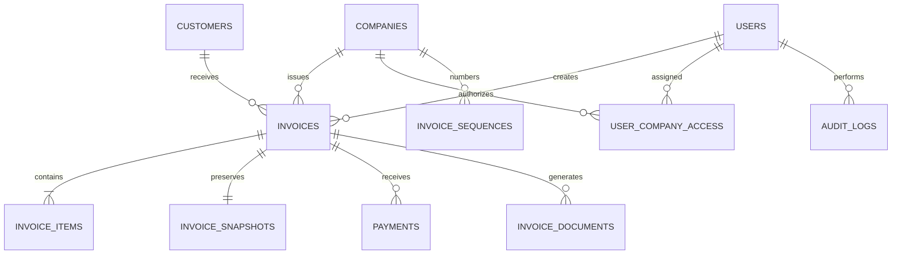

# Mobile Invoice Management System

## Product Requirements Document (PRD)

**Version:** 1.0  
**Platform:** Android + iOS  
**Product type:** Mobile business billing application  
**Primary business domain:** Refrigeration, Air Conditioning and Maintenance Services  
**Currency:** INR (₹)  
**Primary roles:** Admin, Technician

---

# 1. Product Overview

The application is a mobile-first invoice management system for a service business.

It allows technicians to create professional invoices using a standardized company invoice template. Admin users have complete control over the business data, customers, companies, technicians, invoice records, reporting and application settings.

The application must preserve all historical invoice information and generate printable, downloadable PDF invoices.

## 1.1 Product Objectives

1. Digitize manual invoice creation.
2. Maintain a centralized invoice database.
3. Allow technicians to create invoices from mobile devices.
4. Allow technicians to access their own invoice history.
5. Allow admins to manage all invoice records.
6. Maintain separate customer and company databases.
7. Support independently editable invoice dates and billing periods.
8. Automatically calculate invoice totals.
9. Generate professional PDF invoices matching the supplied template.
10. Maintain a complete audit trail of important changes.

# 2. User Roles and Access Control

## 2.1 Admin

Admin has complete application access.

Permissions:

- View dashboard and business analytics.
- Create, view, edit and manage invoices.
- View all technician invoices.
- Create, edit and deactivate customers.
- Create, edit and manage company profiles.
- Create and manage technician accounts.
- Manage invoice numbering.
- Manage invoice templates.
- Manage tax configuration.
- Manage payment records.
- Download and print all invoices.
- Export invoice data.
- View audit logs.
- Manage application settings.

## 2.2 Technician

Technicians have restricted access.

Permissions:

- Login to the application.
- View their dashboard.
- Create new invoices.
- Select existing customers.
- Select an authorized company profile.
- Enter invoice date.
- Enter billing period.
- Add unlimited invoice line items.
- Preview invoices.
- Save drafts.
- Issue invoices.
- View their own invoice history.
- Download their own invoice PDFs.
- Share their own invoice PDFs.
- View invoice details for invoices they created.

Restrictions:

- Cannot access other technicians' invoices.
- Cannot create or modify customer records.
- Cannot create or modify company records.
- Cannot create technician accounts.
- Cannot modify issued invoices.
- Cannot delete issued invoices.
- Cannot access admin reports or application settings.

## 2.3 Permission Matrix

| Module               | Admin      | Technician     |
| -------------------- | ---------- | -------------- |
| Dashboard            | Full       | Own statistics |
| Create invoice       | Yes        | Yes            |
| View all invoices    | Yes        | No             |
| View own invoices    | Yes        | Yes            |
| Edit draft invoices  | Yes        | Own drafts     |
| Edit issued invoices | Controlled | No             |
| Cancel invoice       | Yes        | No             |
| Delete invoice       | Restricted | No             |
| Customers            | Full       | Select only    |
| Companies            | Full       | Select only    |
| User management      | Full       | No             |
| PDF generation       | All        | Own            |
| Reports              | Full       | No             |
| Audit logs           | Full       | No             |
| Settings             | Full       | No             |

All permissions must be enforced by the backend, not merely hidden in the mobile interface.

# 3. Application Modules

## 3.1 Authentication Module

Features:

- Login with username/email and password.
- Secure password hashing.
- Access token and refresh token management.
- Logout.
- Password change.
- Admin password reset for technicians.
- Session expiration.
- Account activation/deactivation.

## 3.2 Dashboard Module

### Admin Dashboard

Display:

- Total invoices.
- Total invoiced amount.
- Current month invoice count.
- Current month billed amount.
- Paid amount.
- Unpaid amount.
- Partially paid amount.
- Recent invoices.
- Monthly billing chart.
- Technician-wise invoice statistics.
- Customer-wise billing summary.

Filters:

- Today.
- This week.
- This month.
- Last month.
- Financial year.
- Custom date range.

### Technician Dashboard

Display:

- My total invoices.
- My invoices this month.
- My total invoice value.
- Recent invoices.
- Draft invoices.
- Quick Create Invoice action.

Technicians must only receive statistics calculated from their own authorized records.

## 3.3 Company Management

Company details must be stored independently from customer details.

An admin can create one or more company profiles.

### Company Fields

| Field                | Type            |
| -------------------- | --------------- |
| Company ID           | UUID            |
| Company name         | Text            |
| Business description | Text            |
| Logo                 | Image           |
| Address line 1       | Text            |
| Address line 2       | Text            |
| City                 | Text            |
| District             | Text            |
| State                | Text            |
| State code           | Text            |
| PIN code             | Text            |
| Email                | Email           |
| Mobile number        | Text            |
| GSTIN/UIN            | Optional text   |
| PAN                  | Optional text   |
| Bank name            | Optional text   |
| Account number       | Optional text   |
| IFSC                 | Optional text   |
| Branch               | Optional text   |
| Invoice footer       | Text            |
| Authorized signatory | Image/text      |
| Status               | Active/Inactive |

Company profiles must be selectable during invoice creation.

Each company must have an independent invoice numbering sequence.

Company profile changes must not silently modify historical invoices.

## 3.4 Customer Management

Admin can manage all customers.

### Customer Fields

| Field          | Type                |
| -------------- | ------------------- |
| Customer ID    | UUID                |
| Customer type  | Individual/Business |
| Customer name  | Text                |
| Contact person | Optional            |
| Email          | Optional            |
| Mobile         | Text                |
| Address line 1 | Text                |
| Address line 2 | Text                |
| City           | Text                |
| State          | Text                |
| State code     | Text                |
| PIN code       | Text                |
| GSTIN/UIN      | Optional            |
| PAN            | Optional            |
| Vendor code    | Optional            |
| Notes          | Optional            |
| Status         | Active/Inactive     |

Features:

- Create customer.
- Edit customer.
- Search customer.
- View customer details.
- View customer invoice history.
- Deactivate customer.

Technicians can select customers but cannot modify customer master records.

Previously issued invoices must retain their original customer details even if the customer profile changes.

# 4. Invoice Management

This is the core application module.

## 4.1 Invoice Header

Every invoice must contain:

| Field              | Description                      |
| ------------------ | -------------------------------- |
| Invoice ID         | Internal UUID                    |
| Invoice number     | Unique generated number          |
| Company            | Issuing company                  |
| Customer           | Selected customer                |
| Invoice date       | Editable date                    |
| Due date           | Optional payment deadline        |
| Billing start date | Independent date                 |
| Billing end date   | Independent date                 |
| Vendor code        | Customer/vendor reference        |
| PAN                | Configured tax identity          |
| GSTIN/UIN          | Configured customer tax identity |
| State name         | Customer state                   |
| State code         | Customer state code              |
| Created by         | Technician/Admin                 |
| Invoice status     | Draft/Issued/Cancelled           |

## 4.2 Invoice Copy Types

The PDF must support:

1. ORIGINAL
2. DUPLICATE
3. TRIPLICATE

The selected copy type must be displayed at the top of the PDF.

The underlying invoice remains the same. Copy type is a print/export designation and does not create a new financial invoice.

## 4.3 Invoice Numbering

Recommended format:

`INV/2026-27/00001`

Rules:

- Unique per company and financial year.
- Automatically generated by the backend.
- Sequence generated transactionally.
- No duplicate invoice numbers.
- Cancelled invoice numbers must not be reused.
- Drafts may use temporary identifiers until officially issued.
- Editing an issued invoice date must not silently change its invoice number.

## 4.4 Invoice Date and Billing Period

These are separate independent fields.

Example:

Invoice Date: 20 November 2026

Billing Start: 01 September 2026

Billing End: 30 September 2026

The application must never automatically change the billing period when the invoice date changes.

Validation:

- Billing start must be before or equal to billing end.
- Invoice date must be valid.
- Due date must be valid.
- Backdating is allowed before issue, subject to business permissions.
- Changes to issued invoices must be controlled and audited.

## 4.5 Invoice Line Items

Each invoice can contain multiple line items.

| Field         | Type       |
| ------------- | ---------- |
| Item ID       | UUID       |
| Serial number | Integer    |
| Description   | Text       |
| Quantity      | Decimal    |
| Rate          | Decimal    |
| Amount        | Calculated |

Calculation:

`Amount = Quantity × Rate`

Example:

| Particulars                     | Qty | Rate | Amount |
| ------------------------------- | --: | ---: | -----: |
| Indoor fan motor                |   1 | 2200 |   2200 |
| Gas leak arrest and gas filling |   1 | 5100 |   5100 |
| Capacitor replacement           |   1 | 1100 |   1100 |
| General service                 |   1 |  500 |    500 |

Line items must support:

- Add item.
- Edit item.
- Remove item.
- Reorder items.
- Change quantity.
- Change rate.
- Add custom descriptions.

The interface should provide common service descriptions as optional reusable presets.

## 4.6 Invoice Calculation Engine

The backend is the authoritative calculation engine.

Formula:

Subtotal = Sum of all line item amounts.

Taxable adjustments = Configured discounts and adjustments.

Tax = Calculated only when applicable tax configuration is enabled.

Grand Total = Subtotal - Discount + Tax + Other Charges + Round Off.

The application must support:

- No-tax invoices.
- Configurable GST treatment.
- Applicable CGST/SGST or IGST.
- Discounts.
- Other charges.
- Round off.
- Final total.
- Total in words.

The supplied sample uses a no-separate-GST-calculation presentation, with a total of ₹53,000 and ₹0 round off. That must be the default reference layout unless the admin enables another tax configuration.

Use decimal arithmetic or integer paise internally. Never rely on JavaScript floating-point arithmetic for financial totals.

## 4.7 Amount in Words

The application must automatically convert the grand total into Indian currency words.

Example:

₹53,000.00

Fifty Three Thousand Rupees Only.

Support:

- Rupees.
- Paise.
- Zero amount.
- Negative adjustment handling where applicable.

## 4.8 Invoice Status

Recommended statuses:

- DRAFT
- ISSUED
- PARTIALLY_PAID
- PAID
- OVERDUE
- CANCELLED

A payment status should be derived from payment records and due dates where applicable. Cancellation is a separate invoice lifecycle state.

# 5. Invoice PDF Template

The uploaded invoice image is the default PDF reference.

The design must preserve its section arrangement.

## 5.1 PDF Layout

### Section 1: Copy Type

Top row:

- ORIGINAL
- DUPLICATE
- TRIPLICATE

### Section 2: Company Header

- Company name.
- Business description.
- Address.
- Email.
- Mobile.

### Section 3: Invoice Heading

Centered title: INVOICE.

### Section 4: Invoice Information

Left:

- Invoice number.

Right:

- Invoice date.

### Section 5: Customer Billing Details

Left:

- BILLING ADDRESS.
- Customer name.
- Customer address.
- GSTIN/UIN.
- State name.
- State code.

Right:

- Vendor code.
- PAN.
- BILL PERIOD.

### Section 6: Particulars Table

Columns:

- Sl.No
- PARTICULARS
- Qty
- Rate
- Amount

### Section 7: Totals

- Currency: INR.
- Total.
- Round Off.
- GRAND TOTAL.

### Section 8: Amount in Words

Invoice Total in Words.

### Section 9: Authorized Signatory

Display company authorized signature or stamp in the bottom section.

## 5.2 PDF Requirements

- A4 portrait.
- Professional black-and-white bordered table design.
- Consistent typography.
- Indian rupee formatting.
- Dynamic row height.
- Multi-page support.
- Repeated table headings on subsequent pages.
- Signature area on final page.
- Original/Duplicate/Triplicate selection.
- Print-ready PDF.
- PDF sharing through native mobile sharing.

Historical PDFs should be reproducible from stored invoice snapshots. Store the generated PDF file as well when practical.

# 6. Invoice Creation Workflow

1. Technician logs in.
2. Opens Create Invoice.
3. Selects an active company profile.
4. Searches and selects customer.
5. Enters invoice date.
6. Enters billing start date.
7. Enters billing end date.
8. Enters due date if applicable.
9. Adds line items.
10. Application calculates amounts.
11. Technician reviews the invoice.
12. Technician saves as draft or issues the invoice.
13. Backend validates permissions and calculations.
14. Backend assigns official invoice number when issued.
15. Invoice snapshot is stored.
16. PDF is generated.
17. Invoice appears in technician's own history.
18. Admin can see the invoice in the global invoice register.

# 7. Invoice History

## Admin Invoice Register

Filters:

- Invoice number.
- Company.
- Customer.
- Technician.
- Invoice date.
- Billing period.
- Status.
- Amount range.

Actions:

- View.
- Download PDF.
- Print.
- Edit according to invoice lifecycle.
- Cancel.
- View audit history.
- Export.

## Technician Invoice History

Display only:

- Their own invoices.
- Invoice number.
- Customer.
- Invoice date.
- Billing period.
- Total amount.
- Status.

Actions:

- View own invoice.
- Download PDF.
- Share PDF.
- View creation details.

No access to other technicians' records.

# 8. Payment Management

Payment tracking is a separate module.

Payment fields:

- Payment ID.
- Invoice ID.
- Payment date.
- Amount.
- Payment method.
- Transaction reference.
- Notes.
- Recorded by.

Supported payment methods:

- Cash.
- UPI.
- Bank transfer.
- Cheque.
- Other.

Payment states:

- Unpaid.
- Partially paid.
- Paid.

The system should support multiple payments against one invoice.

Payment records must be auditable. Corrections should be recorded instead of silently deleting payment history.

# 9. Reports

Admin reports:

1. Invoice summary.
2. Monthly billing report.
3. Financial-year report.
4. Customer-wise billing.
5. Company-wise billing.
6. Technician-wise invoice count.
7. Technician-wise billing.
8. Paid/unpaid report.
9. Outstanding invoice report.
10. Cancelled invoice report.

Export:

- CSV.
- Excel.
- PDF.

# 10. Database Design

Database: PostgreSQL

Primary key: UUID.

Money: NUMERIC(14,2) or integer paise.

Dates: DATE for invoice and billing dates; TIMESTAMPTZ for audit timestamps.

All business tables should have created_at and updated_at where applicable.

## 10.1 users

| Column        | Type                    |
| ------------- | ----------------------- |
| id            | UUID PK                 |
| full_name     | VARCHAR(150)            |
| email         | VARCHAR(255) UNIQUE     |
| phone         | VARCHAR(20)             |
| password_hash | TEXT                    |
| role          | ENUM(admin, technician) |
| is_active     | BOOLEAN                 |
| created_at    | TIMESTAMPTZ             |
| updated_at    | TIMESTAMPTZ             |

## 10.2 companies

| Column               | Type         |
| -------------------- | ------------ |
| id                   | UUID PK      |
| company_name         | VARCHAR(255) |
| business_description | TEXT         |
| logo_url             | TEXT         |
| address_line_1       | TEXT         |
| address_line_2       | TEXT         |
| city                 | VARCHAR(100) |
| district             | VARCHAR(100) |
| state                | VARCHAR(100) |
| state_code           | VARCHAR(10)  |
| pincode              | VARCHAR(10)  |
| email                | VARCHAR(255) |
| phone                | VARCHAR(20)  |
| gstin                | VARCHAR(20)  |
| pan                  | VARCHAR(20)  |
| bank_details         | JSONB        |
| signature_url        | TEXT         |
| invoice_footer       | TEXT         |
| is_active            | BOOLEAN      |
| created_at           | TIMESTAMPTZ  |
| updated_at           | TIMESTAMPTZ  |

## 10.3 customers

| Column         | Type         |
| -------------- | ------------ |
| id             | UUID PK      |
| customer_type  | VARCHAR(30)  |
| customer_name  | VARCHAR(255) |
| contact_person | VARCHAR(150) |
| email          | VARCHAR(255) |
| phone          | VARCHAR(20)  |
| address_line_1 | TEXT         |
| address_line_2 | TEXT         |
| city           | VARCHAR(100) |
| district       | VARCHAR(100) |
| state          | VARCHAR(100) |
| state_code     | VARCHAR(10)  |
| pincode        | VARCHAR(10)  |
| gstin          | VARCHAR(20)  |
| pan            | VARCHAR(20)  |
| vendor_code    | VARCHAR(100) |
| notes          | TEXT         |
| is_active      | BOOLEAN      |
| created_at     | TIMESTAMPTZ  |
| updated_at     | TIMESTAMPTZ  |

## 10.4 invoices

| Column               | Type          |
| -------------------- | ------------- |
| id                   | UUID PK       |
| invoice_number       | VARCHAR(100)  |
| company_id           | UUID FK       |
| customer_id          | UUID FK       |
| created_by           | UUID FK users |
| invoice_date         | DATE          |
| due_date             | DATE          |
| billing_start_date   | DATE          |
| billing_end_date     | DATE          |
| vendor_code_snapshot | VARCHAR(100)  |
| currency             | VARCHAR(3)    |
| subtotal             | NUMERIC(14,2) |
| discount_amount      | NUMERIC(14,2) |
| taxable_amount       | NUMERIC(14,2) |
| tax_amount           | NUMERIC(14,2) |
| other_charges        | NUMERIC(14,2) |
| round_off            | NUMERIC(14,2) |
| grand_total          | NUMERIC(14,2) |
| amount_in_words      | TEXT          |
| status               | VARCHAR(30)   |
| notes                | TEXT          |
| issued_at            | TIMESTAMPTZ   |
| cancelled_at         | TIMESTAMPTZ   |
| created_at           | TIMESTAMPTZ   |
| updated_at           | TIMESTAMPTZ   |

Add unique constraint on company_id + invoice_number.

Add indexes on company_id, customer_id, created_by, invoice_date, status and billing dates.

## 10.5 invoice_items

| Column        | Type          |
| ------------- | ------------- |
| id            | UUID PK       |
| invoice_id    | UUID FK       |
| serial_number | INTEGER       |
| description   | TEXT          |
| quantity      | NUMERIC(12,3) |
| unit          | VARCHAR(30)   |
| rate          | NUMERIC(14,2) |
| amount        | NUMERIC(14,2) |
| created_at    | TIMESTAMPTZ   |

The application must calculate amount on the server.

## 10.6 invoice_snapshots

This table preserves the exact company and customer details used at issuance.

| Column            | Type           |
| ----------------- | -------------- |
| id                | UUID PK        |
| invoice_id        | UUID FK UNIQUE |
| company_snapshot  | JSONB          |
| customer_snapshot | JSONB          |
| invoice_snapshot  | JSONB          |
| template_version  | VARCHAR(30)    |
| created_at        | TIMESTAMPTZ    |

Snapshots must preserve:

- Company name and address.
- Company logo reference.
- GSTIN and PAN.
- Customer billing address.
- Customer GSTIN/UIN.
- Vendor code.
- Invoice dates.
- Billing period.
- All line items.
- Tax and calculation details.
- Grand total.
- Signatory reference.

An issued invoice PDF must use its snapshot, not the current master data.

## 10.7 invoice_sequences

| Column         | Type        |
| -------------- | ----------- |
| id             | UUID PK     |
| company_id     | UUID FK     |
| financial_year | VARCHAR(10) |
| prefix         | VARCHAR(30) |
| next_number    | BIGINT      |
| created_at     | TIMESTAMPTZ |
| updated_at     | TIMESTAMPTZ |

Unique constraint: company_id + financial_year.

Use database transactions and row locking when issuing invoices to prevent duplicate numbering.

## 10.8 payments

| Column                | Type          |
| --------------------- | ------------- |
| id                    | UUID PK       |
| invoice_id            | UUID FK       |
| payment_date          | DATE          |
| amount                | NUMERIC(14,2) |
| payment_method        | VARCHAR(30)   |
| transaction_reference | VARCHAR(255)  |
| notes                 | TEXT          |
| recorded_by           | UUID FK users |
| created_at            | TIMESTAMPTZ   |

## 10.9 invoice_documents

| Column        | Type         |
| ------------- | ------------ |
| id            | UUID PK      |
| invoice_id    | UUID FK      |
| document_type | VARCHAR(30)  |
| copy_type     | VARCHAR(20)  |
| file_url      | TEXT         |
| file_hash     | VARCHAR(128) |
| created_at    | TIMESTAMPTZ  |

## 10.10 audit_logs

| Column      | Type        |
| ----------- | ----------- |
| id          | UUID PK     |
| user_id     | UUID FK     |
| entity_type | VARCHAR(50) |
| entity_id   | UUID        |
| action      | VARCHAR(50) |
| old_values  | JSONB       |
| new_values  | JSONB       |
| ip_address  | INET        |
| created_at  | TIMESTAMPTZ |

Audit logs must be append-only for application users.

## 10.11 Additional Tables

Recommended:

- user_company_access: which companies a technician can issue invoices for.
- service_catalog: reusable service descriptions and default rates.
- invoice_tax_lines: tax breakdowns when enabled.
- refresh_tokens: secure session management.
- invoice_adjustments: controlled financial corrections.
- company_invoice_settings: company-specific numbering and invoice preferences.

# 11. Database Relationships

# 12. API Design

Base URL: `/api/v1`

## Authentication

| Method | Endpoint              | Purpose         |
| ------ | --------------------- | --------------- |
| POST   | /auth/login           | Login           |
| POST   | /auth/refresh         | Refresh session |
| POST   | /auth/logout          | Logout          |
| GET    | /auth/me              | Current user    |
| POST   | /auth/change-password | Change password |

## Dashboard

| Method | Endpoint              | Purpose               |
| ------ | --------------------- | --------------------- |
| GET    | /dashboard/admin      | Admin statistics      |
| GET    | /dashboard/technician | Technician statistics |

## Companies

| Method | Endpoint       | Purpose                   |
| ------ | -------------- | ------------------------- |
| GET    | /companies     | List authorized companies |
| POST   | /companies     | Create company            |
| GET    | /companies/:id | Company details           |
| PATCH  | /companies/:id | Update company            |
| DELETE | /companies/:id | Deactivate company        |

Admin-only management endpoints.

## Customers

| Method | Endpoint                | Purpose                  |
| ------ | ----------------------- | ------------------------ |
| GET    | /customers              | Search customers         |
| POST   | /customers              | Create customer          |
| GET    | /customers/:id          | Customer details         |
| PATCH  | /customers/:id          | Update customer          |
| GET    | /customers/:id/invoices | Customer invoice history |

Admin-only customer management.

## Invoices

| Method | Endpoint              | Purpose                    |
| ------ | --------------------- | -------------------------- |
| GET    | /invoices             | Authorized invoice listing |
| POST   | /invoices             | Create draft               |
| GET    | /invoices/:id         | View authorized invoice    |
| PATCH  | /invoices/:id         | Update permitted draft     |
| POST   | /invoices/:id/issue   | Issue invoice              |
| POST   | /invoices/:id/cancel  | Cancel invoice             |
| POST   | /invoices/:id/preview | Generate preview           |
| GET    | /invoices/:id/pdf     | Download PDF               |
| GET    | /invoices/:id/history | View audit history         |

The GET /invoices endpoint must enforce ownership filtering for technicians.

## Payments

| Method | Endpoint               | Purpose                          |
| ------ | ---------------------- | -------------------------------- |
| GET    | /invoices/:id/payments | List payments                    |
| POST   | /invoices/:id/payments | Record payment                   |
| PATCH  | /payments/:id          | Correct permitted payment record |

## Reports

| Method | Endpoint             | Purpose              |
| ------ | -------------------- | -------------------- |
| GET    | /reports/billing     | Billing report       |
| GET    | /reports/customers   | Customer report      |
| GET    | /reports/technicians | Technician report    |
| GET    | /reports/outstanding | Outstanding invoices |
| GET    | /reports/export      | Export data          |

All endpoints must include authentication, authorization, input validation and appropriate audit logging.

# 13. Mobile Application Screens

## Public Screens

1. Splash screen.
2. Login screen.
3. Forgot password.
4. Session expired screen.

## Admin Screens

1. Admin dashboard.
2. Invoice register.
3. Invoice details.
4. Create invoice.
5. Edit draft invoice.
6. Customer list.
7. Create customer.
8. Customer details.
9. Company list.
10. Company profile.
11. Technician list.
12. Technician profile.
13. Reports.
14. Payment history.
15. Audit logs.
16. Application settings.

## Technician Screens

1. Technician dashboard.
2. Create invoice.
3. Customer selection.
4. Invoice details form.
5. Service item editor.
6. Invoice preview.
7. Invoice history.
8. Invoice details.
9. PDF download/share.

# 14. Recommended Mobile Navigation

### Admin

Bottom navigation:

- Dashboard
- Invoices
- Customers
- Companies
- More

### Technician

Bottom navigation:

- Home
- Create Invoice
- My Invoices
- Profile

Create Invoice should be the most prominent action for technicians.

# 15. Technical Architecture

## Mobile

React Native + Expo + TypeScript.

Recommended libraries:

- Expo Router.
- TanStack Query.
- React Hook Form.
- Zod.
- Zustand.
- Expo SecureStore.
- Native sharing and file-system APIs.

## Backend

Node.js + Fastify + TypeScript.

Recommended modules:

- Authentication.
- Authorization.
- Users.
- Companies.
- Customers.
- Invoices.
- Invoice calculations.
- PDF generation.
- Payments.
- Reports.
- Audit logs.
- File storage.

## Database

PostgreSQL with Drizzle ORM.

## Storage

S3-compatible object storage for:

- Company logos.
- Signatures.
- Generated PDFs.
- Supporting documents.

## PDF Generation

Use server-side HTML/CSS-to-PDF or a dedicated PDF rendering library.

PDF rendering must use stored invoice snapshots.

# 16. Security Requirements

1. Secure password hashing with Argon2id or bcrypt.
2. HTTPS-only API communication.
3. Secure token storage on mobile.
4. Backend-enforced RBAC.
5. Technician ownership verification on every invoice operation.
6. Company access verification.
7. SQL injection prevention through parameterized queries.
8. Request validation.
9. Rate limiting on authentication.
10. Audit logs for sensitive changes.
11. Protected document downloads.
12. Automated database backups.
13. No permanent deletion of issued financial records through ordinary application operations.

# 17. Business Rules

1. Every invoice belongs to one company.
2. Every invoice belongs to one customer.
3. Every invoice has one creator.
4. Billing period and invoice date are independent.
5. Invoice numbering is unique per company and financial year.
6. Invoice totals are calculated on the backend.
7. Issued invoices preserve company/customer snapshots.
8. Technicians can access only their own invoice records.
9. Admin can access all authorized company invoices.
10. Issued invoices cannot be silently modified.
11. Cancelled invoice numbers cannot be reused.
12. Customer and company deactivation must not remove historical invoices.
13. Financial totals must use exact decimal arithmetic.
14. Every important modification must be auditable.

# 18. Non-Functional Requirements

| Requirement    | Target                                               |
| -------------- | ---------------------------------------------------- |
| API response   | Under 500 ms for common operations under normal load |
| PDF generation | Target under 5 seconds for ordinary invoices         |
| Availability   | Target 99.5% initially                               |
| Database       | PostgreSQL                                           |
| Security       | Role-based authorization                             |
| Scalability    | Modular backend architecture                         |
| Mobile support | Android and iOS                                      |
| PDF format     | A4                                                   |
| Currency       | INR                                                  |
| Backup         | Automated daily backup                               |
| Data integrity | Transactional invoice issuance                       |

# 19. Development Roadmap

## Phase 1 — Foundation

- Initialize React Native Expo application.
- Initialize Fastify backend.
- Configure PostgreSQL.
- Configure Drizzle ORM.
- Build authentication.
- Implement Admin and Technician roles.
- Implement authorization middleware.

## Phase 2 — Master Data

- Company management.
- Customer management.
- Technician management.
- Company access assignment.
- Service catalog.

## Phase 3 — Invoice Engine

- Invoice creation.
- Invoice numbering.
- Billing period.
- Editable invoice date.
- Line item calculations.
- Discounts and round-off.
- Amount in words.
- Draft and issued states.

## Phase 4 — PDF Generation

- Recreate supplied invoice template.
- Original/Duplicate/Triplicate.
- Company logo.
- Dynamic customer details.
- Dynamic billing period.
- Dynamic service table.
- Automatic totals.
- PDF storage and sharing.
- Multi-page support.

## Phase 5 — Invoice History

- Admin invoice register.
- Technician own history.
- Search and filters.
- Invoice details.
- Download and share.
- Audit trail.

## Phase 6 — Payments and Reports

- Payment tracking.
- Outstanding invoices.
- Monthly reports.
- Technician reports.
- Excel and CSV export.

## Phase 7 — Testing and Release

- Role permission tests.
- Invoice calculation tests.
- PDF visual comparison.
- Duplicate numbering tests.
- Database transaction tests.
- Security testing.
- Android release.
- iOS release.

# 20. Acceptance Criteria

The first production release is considered complete when:

- Admin can log in and access all authorized management features.
- Technician can log in and create invoices.
- Technician can only view their own invoices.
- Technician can download and share their own invoice PDFs.
- Admin can view invoices created by all technicians.
- Customer and company details are stored independently.
- Invoice date can be modified independently of billing period.
- Invoice line items calculate correctly.
- Invoice numbering does not generate duplicates.
- The PDF closely matches the supplied invoice template.
- Original, Duplicate and Triplicate copies can be generated.
- Amount in words is accurate.
- Historical invoices preserve their original details.
- Audit history records important modifications.
- Unauthorized API access is rejected.

---

## 21. Scope Boundaries

**Included in the first release**

- Two roles.
- Mobile application.
- Company management.
- Customer management.
- Invoice creation.
- Invoice history.
- PDF generation.
- Invoice numbering.
- Billing periods.
- Basic payment tracking.
- Admin reports.
- Audit history.

**Future enhancements**

- Offline invoice drafting and synchronization.
- WhatsApp invoice delivery.
- Email invoice delivery.
- Automatic recurring invoices.
- Customer portal.
- E-invoice and e-way bill integrations where applicable.
- Accounting software integrations.
- Web-based admin panel.

**Final product direction:** A mobile-first service invoice management platform with controlled technician access, centralized administration, and a reusable professional invoice template based on the supplied reference document.
